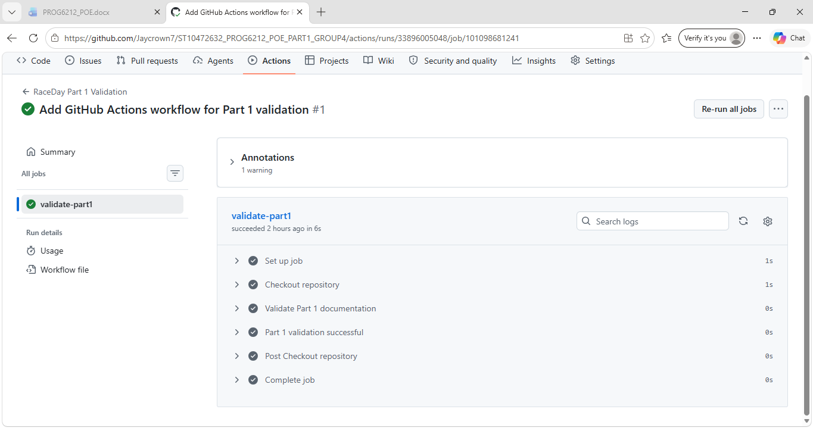

# ST10472632_PROG6212_POE_PART1_GROUP4
ST10472632

# RaceDay

## Project Description

RaceDay is a web-based event management system designed for road running, walking, and cycling events in South Africa. The system allows participants to view available events, register for events, manage their profiles, and view their results.

Event organisers can use RaceDay to create and manage events, categories, participant enrolments, and event results. The system provides a simple and organised way to manage event information and improve the overall experience for both organisers and participants.


## Project Features 

### Participant Features

* Register and log in to the system
* Manage a personal user profile
* View available events
* View event categories
* Enrol in events
* View event results

### Event Organiser Features

* Create and manage events
* Manage event categories
* View participant enrolments
* Manage event results
* Update and maintain event information

### System Features

* User authentication
* Event management
* Category management
* Event enrolment management
* Results management
* Responsive and user-friendly interface


## Part 1

Part 1 focuses on planning and database design before API development.

The following documents are included:

- Entity Relationship Diagram (ERD)
- RESTful API Endpoint Plan
- SQL Server Database Script
- GitHub Actions CI/CD validation workflow

## Database

The RaceDay database is designed using Microsoft SQL Server.

The database contains the following entities:

- User
- User Profile
- Event
- Category
- Enrolment
- Result

The SQL script creates the database, tables, relationships, constraints, and sample data.

## API Planning

The API endpoint plan covers:

- Authentication
- User Profiles
- Events
- Categories
- Event Enrolments
- Results

The planned API will be implemented in Part 2 using C#.

## GitHub Actions / CI/CD

A GitHub Actions workflow is included to validate that the required Part 1 documentation exists in the repository.

The workflow checks for:

- The `docs` folder
- The RaceDay ERD
- The API Endpoint Plan PDF
- The RaceDay SQL database script

## Part 1 Documentation

- [RaceDay ERD](docs/RaceDay_ERD.png)
- [API Endpoint Plan](docs/RaceDay_API_Endpoint_Plan.pdf)
- [SQL Database Script](docs/RaceDay_Database.sql)
- [Database Testing](docs/Database_Testing.md)

## Part 1 Validation

The SQL database was tested successfully in SQL Server Management Studio.

The GitHub Actions workflow was also executed successfully and confirmed that the required Part 1 documentation is present in the repository.

### Successful CI/CD Build



## Documentation

All Part 1 planning documents are available in the `docs` folder.

## Video Presentation

YouTube video:

**[https://youtu.be/YCT6UP938xA]**

## Part 1 Deliverables

Part 1 contains the following completed deliverables:

1. Entity Relationship Diagram
2. RESTful API Endpoint Plan
3. SQL Server Database Script
4. GitHub Actions CI/CD Validation
5. Project README and Video Presentation

## Project Development

RaceDay will continue to be developed across the following parts:

- Part 1 – System planning, ERD, API planning, and database
- Part 2 – C# RESTful API, database integration, unit testing, and CI/CD
- Part 3 – MVC web application, Azure Blob Storage, and Docker containerisation
  

  # RaceDay — Part 2: RESTful Web API

## 1. Overview

RaceDay is a web-based event management system designed for road running, walking and cycling events in South Africa.

Part 2 extends the Part 1 design by implementing a RESTful Web API using ASP.NET Core. The API allows participants and organisers to access and manage event information according to their assigned roles.

The system supports user authentication, profile management, event management, categories, enrolments and race results.

## 2. Technologies Used

The following technologies were used to develop the API:

* **C#:** Main programming language.
* **ASP.NET Core Web API:** Development of RESTful endpoints.
* **.NET 10:** Application framework.
* **Entity Framework Core:** Database access and data management.
* **Microsoft SQL Server:** Relational database management.
* **Cookie Authentication:** User authentication and session management.
* **Role-Based Authorisation:** Controls access to protected endpoints.
* **Swagger UI:** API documentation and interactive endpoint testing.
* **xUnit:** Unit testing.
* **SQLite In-Memory:** Isolated database testing.
* **GitHub Actions:** Automated build and test validation.
* **Git and GitHub:** Version control and source code management.

## 3. System Roles

RaceDay supports two main user roles.

### 3.1 Participant

Participants can:

* Register and log in.
* View available events.
* View event categories.
* View and update their own profile.
* Enrol in events.
* View their own enrolments.
* Cancel their own enrolments.
* View their race results.

### 3.2 Organiser

Organisers can:

* Register and log in.
* View and update their own profile.
* Create, update and delete their own events.
* Manage event categories.
* View enrolments for their events.
* Record race results.
* Update race results.

Role-based authorisation protects restricted endpoints from unauthorised access.

## 4. API Endpoints

The following table summarises the main API endpoints implemented in RaceDay.

### 4.1 Authentication

| HTTP Method | Endpoint             | Purpose                             |
| ----------- | -------------------- | ----------------------------------- |
| POST        | `/api/auth/register` | Register a new user                 |
| POST        | `/api/auth/login`    | Authenticate a user                 |
| POST        | `/api/auth/logout`   | Log out the current user            |
| GET         | `/api/auth/me`       | Retrieve the current user's details |

### 4.2 User Profiles

| HTTP Method | Endpoint             | Purpose                             |
| ----------- | -------------------- | ----------------------------------- |
| GET         | `/api/users/profile` | Retrieve the current user's profile |
| PUT         | `/api/users/profile` | Update the current user's profile   |

### 4.3 Events

| HTTP Method | Endpoint           | Purpose                   |
| ----------- | ------------------ | ------------------------- |
| GET         | `/api/events`      | Retrieve available events |
| GET         | `/api/events/{id}` | Retrieve an event by ID   |
| POST        | `/api/events`      | Create an event           |
| PUT         | `/api/events/{id}` | Update an event           |
| DELETE      | `/api/events/{id}` | Delete an event           |

Event creation, modification and deletion are restricted to authorised organisers.

### 4.4 Categories

| HTTP Method | Endpoint                           | Purpose                          |
| ----------- | ---------------------------------- | -------------------------------- |
| GET         | `/api/events/{eventId}/categories` | Retrieve categories for an event |
| GET         | `/api/categories/{id}`             | Retrieve a category by ID        |
| POST        | `/api/events/{eventId}/categories` | Create an event category         |
| PUT         | `/api/categories/{id}`             | Update a category                |
| DELETE      | `/api/categories/{id}`             | Delete a category                |

Category management is restricted to authorised organisers, while category retrieval requires authentication according to the implemented access rules.

### 4.5 Enrolments

| HTTP Method | Endpoint                           | Purpose                                       |
| ----------- | ---------------------------------- | --------------------------------------------- |
| POST        | `/api/enrolments`                  | Enrol in an event                             |
| GET         | `/api/enrolments/my`               | Retrieve the current participant's enrolments |
| GET         | `/api/events/{eventId}/enrolments` | Retrieve enrolments for an event              |
| DELETE      | `/api/enrolments/{id}`             | Cancel an enrolment                           |

Participants manage their own enrolments, while organisers can view enrolments for their events.

### 4.6 Results

| HTTP Method | Endpoint                        | Purpose                                    |
| ----------- | ------------------------------- | ------------------------------------------ |
| POST        | `/api/results`                  | Record a race result                       |
| GET         | `/api/results/my`               | Retrieve the current participant's results |
| GET         | `/api/events/{eventId}/results` | Retrieve results for an event              |
| PUT         | `/api/results/{id}`             | Update a race result                       |

Result recording and updating are restricted to authorised organisers.

## 5. Database Configuration

RaceDay uses Microsoft SQL Server to store application data.

Entity Framework Core manages database access, while the application's database context defines the relationship between the application entities.

The database connection is configured in `appsettings.json`.

Example connection string for a local SQL Server Express installation:

```json
{
  "ConnectionStrings": {
    "DefaultConnection": "Server=KGAUGELO\\SQLEXPRESS;Database=RaceDayDB;Trusted_Connection=True;TrustServerCertificate=True;"
  }
}
```

The connection string must be adjusted when running the application on a different computer or SQL Server instance.

**Important:** The SQL Server database must be available and configured before running database-dependent API operations.

The SQL script and database design documentation from Part 1 are included in the project repository.

## 6. Running the Application

### Prerequisites

Ensure that the following are installed:

* .NET 10 SDK
* Microsoft SQL Server or SQL Server Express
* Visual Studio or another compatible .NET development environment
* Git

### Step 1: Clone the repository

Clone the RaceDay repository from GitHub and open the solution.

### Step 2: Restore dependencies

Open a terminal in the repository's root directory and execute:

```bash
dotnet restore RaceDay.slnx
```

### Step 3: Build the solution

Run:

```bash
dotnet build RaceDay.slnx
```

### Step 4: Configure the database

Check the connection string in `RaceDay.API/appsettings.json` and ensure that it matches the local SQL Server configuration.

### Step 5: Run the API

Execute:

```bash
dotnet run --project RaceDay.API/RaceDay.API.csproj
```

The application will display its listening address in the terminal.

Open the displayed application address followed by `/swagger` to access Swagger UI.

For example:

`http://localhost:5021/swagger`

The actual port may differ depending on the local launch configuration.

## 7. Swagger API Documentation

Swagger UI provides interactive documentation for the RaceDay API.

It allows developers to:

* View available API endpoints.
* Identify HTTP methods and endpoint parameters.
* Inspect request and response schemas.
* Submit requests to the API.
* Review HTTP response status codes.
* Explore authentication and role-restricted operations.

Swagger UI is available in the Development environment.

## 8. Authentication and Authorisation

RaceDay uses cookie-based authentication to maintain the authenticated user's identity.

After a successful login, the API establishes an authentication cookie containing the user's claims. These claims include the user identifier, name, email and role.

The API uses role-based authorisation to restrict access to protected operations.

Unauthenticated requests to protected endpoints are rejected, while authenticated users must have the required role to access restricted operations.

Users can retrieve their current identity through the `/api/auth/me` endpoint.

## 9. Unit Testing

The solution includes an automated unit testing project named `RaceDay.Tests`.

The tests cover application behaviour involving authentication, events, categories, enrolments, results and user profiles.

SQLite In-Memory is used for isolated database testing where appropriate, allowing tests to execute without modifying the actual RaceDay SQL Server database.

To run the tests, execute:

```bash
dotnet test RaceDay.slnx
```

The command builds the solution and executes the available automated tests.

## 10. Continuous Integration

GitHub Actions is used to automate build and test validation.

The workflow is located at:

`.github/workflows/part2-validation.yml`

The workflow validates the solution by restoring dependencies, building the project and running automated tests.

This helps identify compilation errors and failing tests when changes are pushed to the repository.

**Build status:** Refer to the latest GitHub Actions workflow run for the current build and test results.

**GitHub Actions results screenshot:** Add a screenshot of the successful workflow run here before submission.

## 11. Version Control

Git and GitHub were used throughout development to track changes and maintain the project history.

Development work was organised into commits to document implementation progress, fixes, testing and documentation updates.

The Part 2 implementation is maintained in the `part2-api` branch.

## 12. Demonstration Video

A demonstration video will present the completed RaceDay API and its main functionality.

The demonstration should cover:

* Application startup.
* Swagger UI and the available endpoints.
* User registration and login.
* Participant and organiser roles.
* Event and category management.
* Enrolment functionality.
* Race result management.
* Automated unit test results.

**YouTube demonstration:** Add the published YouTube video link here once the recording has been uploaded.

## 13. Conclusion

RaceDay Part 2 extends the original project design by providing a RESTful API for managing road running, walking and cycling events.

The implementation combines ASP.NET Core, Entity Framework Core, Microsoft SQL Server, cookie-based authentication and role-based authorisation.

Automated unit testing and GitHub Actions provide additional validation of the application during development.

The API provides the foundation for managing users, events, categories, enrolments and race results within the RaceDay system.


